# Agent run: token usage vs output quality

The M&A CRM run of 2026-10-10. Coordinator `dragon` and its 47 subagent sessions. Read-only analysis, 2026-10-12.

Interactive view: `~/.jcode-notes/ma-crm/agent-map/index.html` (agent map, one card per session, scatter plots). Raw data: `~/.jcode-notes/ma-crm/agent-map/data.json`.

## Question

Did the implementation agents that used more tokens, or ran with a bigger context, ship work that failed more of its acceptance criteria?

## Answer

**No measurable relationship.** Across n = 20 ticket agents:

| Pair | n | Pearson r | p (two-sided) | Spearman ρ |
|---|---|---|---|---|
| Peak context vs failed % | 20 | +0.157 | 0.51 | +0.012 |
| Total tokens vs failed % | 20 | +0.308 | 0.19 | +0.014 |
| Output tokens vs failed % | 20 | +0.192 | 0.42 | +0.190 |
| Total tokens vs criteria count (size check) | 20 | +0.200 | 0.40 | -0.195 |
| Peak context vs failed count | 20 | +0.198 | 0.40 | +0.075 |
| Total tokens vs failed %, without dog | 19 | -0.187 | 0.44 | -0.117 |
| Peak context vs failed %, without dog | 19 | -0.200 | 0.41 | -0.120 |
| Total tokens incl. bird/cat vs failed % | 20 | +0.304 | 0.19 | +0.022 |

With n = 20, neither token measure tracks quality. Peak context against failed % gives Pearson r = +0.16 (p = 0.51). Total tokens against failed % gives r = +0.31 (p = 0.19). The rank correlations are close to zero (Spearman ρ = +0.01 and +0.01). So the small positive Pearson values come from one outlier, **dog** (#20: 111.9M tokens, 556K peak, 38.9% failed). Without dog, both signs flip (r = -0.20 and -0.19, n = 19).

Caveats:

- **Small n.** With 20 points, |r| would need to pass about 0.44 to reach p < 0.05. Nothing comes close.
- **Ticket size and type confound everything.** Tickets carry 6 to 20 criteria, and token use does not even track criteria count (r = +0.20). #20 was cross-cutting production readiness, which mostly cannot be proven on a laptop (uptime, load at scale, manual accessibility). That probably explains both its token use and its failures.
- **Who failed is not always who was asked.** #5's backend-only agent (hatchling, top of the list) carries 8 UI gaps that calf (#6) was told to build. 17 of the 56 failures carry an *ambiguous* attribution note.
- **The reviews differ.** Review 1 was a code review at 27f0e11, before #20 merged. Review 2 was per-criterion traceability. Later tickets were judged on a bigger codebase, with more cross-ticket seams.
- **Failure types.** Most failures were missing screens (API done, no UI) or narrowings the agent disclosed in the decision report. A context-exhaustion effect would look different: forgotten criteria or broken tests.
- **Per-criterion rate.** 56 of 272 ticket criteria (20.6%) failed first time. The mean of the per-agent rates is 20.2%.

Conclusion: this run gives no evidence that more tokens or a bigger context produced worse output, but n is far too small to rule out a modest effect.

## Method

**Sessions.** Every `~/.jcode/sessions/session_*.json` created on 2026-10-10 whose working dir is the repo or `/Users/serge/Projects/crm-*`, and which is either the coordinator `session_dragon_1791594378843_3abb849d09a66f69` or has it as `parent_id`. That gives 48 sessions: the coordinator plus 47 children. Every child has the coordinator as its `parent_id`, so the fallback was never needed. Messages appended to `session_*.journal.jsonl` after the last JSON snapshot are merged in by message id. This matters for sauropod (all 167 of its messages were only in the journal), rooster (49), ram (13) and dragon (266).

**Token figures.** Summed over every message's `token_usage`: `input_tokens`, `output_tokens`, `cache_read_input_tokens`, `cache_creation_input_tokens`. Total = the sum of the four. Peak context = the largest `prompt_tokens` of any single model call. Model calls = messages carrying `token_usage`. Duration = `created_at` to the last message timestamp. The coordinator is still alive and answered questions about the run on 10-11 and 10-12 (including the request for this map). Its figures are cut at the end of 2026-10-10 UTC, and the later activity is reported separately in `after_run`.

**Roles.** Read from each session's first user message. Every ticket number in the brief matched its prompt (`Implement GitHub issue #N`), and the build asserts this. Two sessions the brief did not name were found and classified: **ladybug** (review-2 spec reviewer that failed, then split into mosquito/pig/ox) and **sauropod** (review-2 spec-C fixer, killed and resumed by tiger).

**Postmortems.** Matched by role, ticket or fix scope, and time. 37 sessions have one. The other 11 have none: read-only reviewers and verifiers, the crashed bird and seedling, the killed sauropod, and the first merger, duckling.

**Criteria.** Each ticket's criterion IDs come from `gh issue view N`: the "User stories covered" list (with explicit `(criteria …)` subsets) checked against the `- [ ]` count under each story. #20's four cross-cutting criteria are numbered X-1..X-4 as in review-spec-c.md. That gives 272 criteria over 20 tickets.

**Failed first time.** A criterion of ticket N counts once, even with several sources, when a later review found that ticket's work did not meet it:
- review 1 (`review.md`): each B/S finding mapped to the criterion it cites or breaks;
- review 2 (`review-spec-a/b/c.md`): every WEAK, MISSING or CONTRADICTS row;
- `docs/DECISION-REPORT.md`: rows marked "Superseded by review 2" (a silent narrowing counts as failed).

**Attribution.** A failure goes to the ticket whose issue lists the criterion. `git log feat/ma-crm` confirmed the ticket commits behind each one (the commits are in `data.json`). When a finding hit code from one ticket but a criterion owned by another, it is listed on the code's agent as a *cross-ticket finding* and left out of its %. Where ownership and code split (e.g. #5 criteria whose UI calf was told to build), the failure stays with the criterion's ticket and carries an **ambiguous** note. Excluded: review-1 findings with no criterion (S5 layering, S11 test hooks, S12 formula injection), review-1 S14's NFR part (#20 had not merged yet), D86 (written by fixer fish), and D8 (already fixed before review 2).

**Scored agents.** One per ticket, the agent that built it. bird (crashed before writing code) and cat (finished seedling's merge) are shown but not scored, so seedling carries #12 and bug carries #14.

**Statistics.** Pearson r with a two-sided t-test p-value, plus Spearman ρ, over the 20 scored agents. Computed in plain Python, no libraries.

## How the "failed first time" percentage is computed

For each implementation agent:

> **failed %** = criteria of its ticket that a later review found unmet ÷ all criteria of its ticket

1. **Denominator: the ticket's criteria.** Each of the 20 tickets is a GitHub issue that lists the spec stories it covers. Every acceptance criterion (each `- [ ]` line) under those stories is counted. That gives 272 criteria over the 20 tickets. #5, for example, has 18.
2. **Numerator: criteria a later review found unmet.** A criterion counts once as failed, even when several sources flag it, if any of these says the ticket's work did not meet it:
   - **Review 1** (security and Chinese wall): each blocker or should-fix finding, mapped to the criterion it breaks.
   - **Review 2** (the per-criterion spec trace): every criterion marked WEAK (a test exists but does not really prove the criterion), MISSING or CONTRADICTS.
   - **Overturned decisions:** a row in `docs/DECISION-REPORT.md` marked "Superseded by review 2", where the agent had quietly narrowed the spec.
3. **Attribution: which agent a failure counts against.**
   - It counts against the ticket whose issue lists that criterion. The git history confirmed which agent's commits implemented it.
   - Findings with no matching criterion are left out (e.g. formula injection, test endpoints).
   - So are findings about code that had not merged yet when the review ran.
   - Crashed or resumed attempts are not scored. bird (#14, crashed before writing code) and cat (finished #12's merge) appear on the map but carry no %. The agent that actually built the ticket carries it.

**Worked example: #5 companies and contacts, 44.4% (8 of 18).** Review 2 marked 8 of #5's 18 criteria MISSING or WEAK, almost all because no screen existed for them: company register lookup (CO-01 c1), duplicate links (CO-01 c2), financials (CO-02 c1–c4), the group tree (CO-03 c1) and the contact edit form (CON-01 c2). The API and its tests were done.

**How to read the number.**
- **Two agents can share a failure.** hatchling built only #5's backend, and the coordinator told calf (#6) to build #5's screens. So those 8 failures are really shared between two agents. They are flagged *ambiguous*, as are 9 others: 17 of the 56 failures in total.
- **It is a strict bar.** A WEAK criterion fails even when the feature works, because the test did not really prove it. The % measures "proven by a test", not "broken".
- **The reviews were not uniform.** Review 1 read an earlier state of the branch (27f0e11, before #20 merged). Review 2 traced every criterion, so later or larger tickets met a more thorough check.
- **It is hand-attributed.** The mapping from review findings to criteria was built by reading the review files (`failures.py` in the scratch dir, output in `data.json`). It is a careful estimate, not an independent measurement.

## Agent map

Every session of the run. The coordinator at the left, its subagents grouped by phase. Each card shows the session name and ticket, its role, total tokens, peak context and, for implementation agents, the share of acceptance criteria that failed the first time.

- Colour: green under 15% failed, yellow 15-29%, red 30% or more. Grey cards are not implementation agents, or have no failure rate (a crashed or resumed attempt).
- A thick orange border marks a peak context over 200K tokens.
- Dotted arrows: a session started by another subagent rather than by the coordinator.

```mermaid
flowchart LR
  dragon["<b>dragon</b><br/>coordinator<br/>93.9M tok · peak 444K"]:::coord
  subgraph tickets["Tickets (implementation)"]
    direction TB
    humpback["<b>humpback · #1</b><br/>implementation<br/>18.9M tok · peak 317K<br/>failed 27.3% (3/11)"]:::mid
    wyvern["<b>wyvern · #2</b><br/>implementation<br/>10.9M tok · peak 217K<br/>failed 29.4% (5/17)"]:::mid
    macaque["<b>macaque · #3</b><br/>implementation<br/>10.2M tok · peak 189K<br/>failed 14.3% (2/14)"]:::good
    tigress["<b>tigress · #4</b><br/>implementation<br/>9.0M tok · peak 177K<br/>failed 0.0% (0/19)"]:::good
    hatchling["<b>hatchling · #5</b><br/>implementation<br/>4.0M tok · peak 121K<br/>failed 44.4% (8/18)"]:::bad
    calf["<b>calf · #6</b><br/>implementation<br/>20.2M tok · peak 329K<br/>failed 12.5% (2/16)"]:::good
    puppy["<b>puppy · #7</b><br/>implementation<br/>5.5M tok · peak 133K<br/>failed 23.1% (3/13)"]:::mid
    retriever["<b>retriever · #8</b><br/>implementation<br/>13.8M tok · peak 251K<br/>failed 7.7% (1/13)"]:::good
    microbe["<b>microbe · #9</b><br/>implementation<br/>17.3M tok · peak 272K<br/>failed 33.3% (4/12)"]:::bad
    mushroom["<b>mushroom · #10</b><br/>implementation<br/>25.5M tok · peak 300K<br/>failed 8.3% (1/12)"]:::good
    rose["<b>rose · #11</b><br/>implementation<br/>17.6M tok · peak 249K<br/>failed 12.5% (2/16)"]:::good
    seedling["<b>seedling · #12</b><br/>implementation<br/>26.6M tok · peak 309K<br/>failed 10.0% (1/10)"]:::good
    cat["<b>cat · #12</b><br/>implementation<br/>960K tok · peak 61K"]:::other
    maple["<b>maple · #13</b><br/>implementation<br/>18.4M tok · peak 289K<br/>failed 25.0% (5/20)"]:::mid
    bird["<b>bird · #14</b><br/>implementation<br/>1.2M tok · peak 93K"]:::other
    bug["<b>bug · #14</b><br/>implementation<br/>24.3M tok · peak 318K<br/>failed 13.3% (2/15)"]:::good
    sabertooth["<b>sabertooth · #15</b><br/>implementation<br/>11.8M tok · peak 234K<br/>failed 10.0% (1/10)"]:::good
    pawprint["<b>pawprint · #16</b><br/>implementation<br/>18.4M tok · peak 284K<br/>failed 18.2% (2/11)"]:::mid
    chipmunk["<b>chipmunk · #17</b><br/>implementation<br/>21.2M tok · peak 263K<br/>failed 33.3% (3/9)"]:::bad
    mizaru["<b>mizaru · #18</b><br/>implementation<br/>9.4M tok · peak 178K<br/>failed 16.7% (1/6)"]:::mid
    iwazaru["<b>iwazaru · #19</b><br/>implementation<br/>25.8M tok · peak 295K<br/>failed 25.0% (3/12)"]:::mid
    dog["<b>dog · #20</b><br/>implementation<br/>111.9M tok · peak 556K<br/>failed 38.9% (7/18)"]:::bad
  end
  subgraph mergers["Mergers"]
    direction TB
    duckling["<b>duckling</b><br/>merger<br/>1.5M tok · peak 79K"]:::other
    kikazaru["<b>kikazaru</b><br/>merger<br/>4.5M tok · peak 110K"]:::other
    tulip["<b>tulip</b><br/>merger<br/>7.3M tok · peak 144K"]:::other
    ant["<b>ant</b><br/>merger<br/>1.7M tok · peak 67K"]:::other
    chicken["<b>chicken</b><br/>merger<br/>976K tok · peak 60K"]:::other
    cricket["<b>cricket</b><br/>merger<br/>875K tok · peak 65K"]:::other
    dove["<b>dove</b><br/>merger<br/>821K tok · peak 56K"]:::other
    giraffe["<b>giraffe</b><br/>merger<br/>21.4M tok · peak 251K"]:::other
    turkey["<b>turkey</b><br/>merger<br/>11.5M tok · peak 165K"]:::other
  end
  subgraph review1["Review 1"]
    direction TB
    eagle["<b>eagle</b><br/>reviewer<br/>12.4M tok · peak 237K"]:::other
  end
  subgraph review1_fixers["Review 1 fixers"]
    direction TB
    fish["<b>fish</b><br/>fixer<br/>30.4M tok · peak 278K"]:::other
    fox["<b>fox</b><br/>fixer<br/>22.8M tok · peak 246K"]:::other
  end
  subgraph review2["Review 2"]
    direction TB
    ladybug["<b>ladybug</b><br/>reviewer<br/>8.1M tok · peak 211K"]:::other
    lobster["<b>lobster</b><br/>reviewer<br/>7.3M tok · peak 150K"]:::other
    mosquito["<b>mosquito</b><br/>reviewer<br/>5.6M tok · peak 184K"]:::other
    ox["<b>ox</b><br/>reviewer<br/>9.2M tok · peak 197K"]:::other
    pig["<b>pig</b><br/>reviewer<br/>5.4M tok · peak 191K"]:::other
  end
  subgraph review2_fixers["Review 2 fixers"]
    direction TB
    owl["<b>owl</b><br/>fixer<br/>4.8M tok · peak 109K"]:::other
    rat["<b>rat</b><br/>fixer<br/>10.8M tok · peak 167K"]:::other
    ram["<b>ram</b><br/>fixer<br/>27.2M tok · peak 275K"]:::other
    rooster["<b>rooster</b><br/>fixer<br/>31.0M tok · peak 272K"]:::other
    shrimp["<b>shrimp</b><br/>fixer<br/>5.6M tok · peak 152K"]:::other
    sauropod["<b>sauropod</b><br/>fixer<br/>8.9M tok · peak 168K"]:::other
    tiger["<b>tiger</b><br/>fixer<br/>8.6M tok · peak 152K"]:::other
  end
  subgraph verification["Verification"]
    direction TB
    rabbit["<b>rabbit</b><br/>verifier<br/>8.1M tok · peak 200K"]:::other
  end
  dragon --> tickets
  dragon --> mergers
  dragon --> review1
  dragon --> review1_fixers
  dragon --> review2
  dragon --> review2_fixers
  dragon --> verification
  style dragon stroke:#c2410c,stroke-width:3px
  style humpback stroke:#c2410c,stroke-width:3px
  style wyvern stroke:#c2410c,stroke-width:3px
  style calf stroke:#c2410c,stroke-width:3px
  style iwazaru stroke:#c2410c,stroke-width:3px
  style retriever stroke:#c2410c,stroke-width:3px
  style pawprint stroke:#c2410c,stroke-width:3px
  style sabertooth stroke:#c2410c,stroke-width:3px
  style microbe stroke:#c2410c,stroke-width:3px
  style mushroom stroke:#c2410c,stroke-width:3px
  style rose stroke:#c2410c,stroke-width:3px
  style maple stroke:#c2410c,stroke-width:3px
  style seedling stroke:#c2410c,stroke-width:3px
  style bug stroke:#c2410c,stroke-width:3px
  style chipmunk stroke:#c2410c,stroke-width:3px
  style dog stroke:#c2410c,stroke-width:3px
  style eagle stroke:#c2410c,stroke-width:3px
  style fish stroke:#c2410c,stroke-width:3px
  style fox stroke:#c2410c,stroke-width:3px
  style giraffe stroke:#c2410c,stroke-width:3px
  style ladybug stroke:#c2410c,stroke-width:3px
  style ram stroke:#c2410c,stroke-width:3px
  style rooster stroke:#c2410c,stroke-width:3px
  classDef coord fill:#1e293b,color:#fff,stroke:#0f172a
  classDef good fill:#dcfce7,stroke:#16a34a
  classDef mid fill:#fef9c3,stroke:#ca8a04
  classDef bad fill:#fee2e2,stroke:#dc2626
  classDef other fill:#f1f5f9,stroke:#64748b
```

## Sessions

Peak context over 200K is in bold. "Failed first time" = failed criteria / the ticket's criteria. Only one agent per ticket is scored.

| Session | Role | Ticket / scope | Model | Input | Output | Cache read | Cache write | Peak context | Failed first time | Postmortem |
|---|---|---|---|---|---|---|---|---|---|---|
| dragon | coordinator | Coordinator: split the spec into 20 tickets, spawned and mer | claude-opus-5-5 | 268K | 163K | 88.5M | 4.9M | **444K** |  | [2026-10-10-2256…](../../postmortem/2026-10-10-2256-main-ma-crm-implementation.md) |
| humpback | implementation | #1 | claude-opus-5-5 | 191K | 191K | 18.2M | 289K | **317K** | 27.3% (3/11) | [2026-10-10-0340…](../../postmortem/2026-10-10-0340-worker-crm-foundation.md) |
| wyvern | implementation | #2 | claude-opus-5-5 | 131K | 194K | 10.4M | 189K | **217K** | 29.4% (5/17) | [2026-10-10-0419…](../../postmortem/2026-10-10-0419-worker-two-factor-login.md) |
| macaque | implementation | #3 | claude-opus-5-5 | 107K | 92K | 9.9M | 161K | 189K | 14.3% (2/14) | [2026-10-10-0449…](../../postmortem/2026-10-10-0449-worker-sessions-logout-mobile.md) |
| tigress | implementation | #4 | claude-opus-5-5 | 104K | 119K | 8.6M | 149K | 177K | 0.0% (0/19) | [2026-10-10-0445…](../../postmortem/2026-10-10-0445-worker-ma-crm-t4-invitations-passwords.md) |
| hatchling | implementation | #5 | claude-opus-5-5 | 49K | 84K | 3.7M | 93K | 121K | 44.4% (8/18) | [2026-10-10-0357…](../../postmortem/2026-10-10-0357-worker-companies-contacts-picklists.md) |
| calf | implementation | #6 | claude-opus-5-5 | 203K | 189K | 19.5M | 301K | **329K** | 12.5% (2/16) | [2026-10-10-0432…](../../postmortem/2026-10-10-0432-worker-mandates-deal-team.md) |
| puppy | implementation | #7 | claude-opus-5-5 | 63K | 88K | 5.3M | 104K | 133K | 23.1% (3/13) | [2026-10-10-0456…](../../postmortem/2026-10-10-0456-worker-activities-tasks-notifications.md) |
| retriever | implementation | #8 | claude-opus-5-5 | 147K | 146K | 13.3M | 222K | **251K** | 7.7% (1/13) | [2026-10-10-0905…](../../postmortem/2026-10-10-0905-worker-ticket-8-pipeline.md) |
| microbe | implementation | #9 | claude-opus-5-5 | 173K | 304K | 16.5M | 244K | **272K** | 33.3% (4/12) | [2026-10-10-1002…](../../postmortem/2026-10-10-1002-worker-t9-conflict-kyc.md) |
| mushroom | implementation | #10 | claude-opus-5-5 | 186K | 386K | 24.7M | 271K | **300K** | 8.3% (1/12) | [2026-10-10-1028…](../../postmortem/2026-10-10-1028-worker-ticket-10-fees-invoices.md) |
| rose | implementation | #11 | claude-opus-5-5 | 148K | 254K | 16.9M | 221K | **249K** | 12.5% (2/16) | [2026-10-10-1136…](../../postmortem/2026-10-10-1136-worker-ticket-11-wall-crossing.md) |
| seedling | implementation | #12 | claude-opus-5-5 | 195K | 143K | 26.0M | 280K | **309K** | 10.0% (1/10) | none (died mid-merge; cat wrote the #12 postmortem) |
| cat | implementation | #12 | claude-opus-5-5 | 28K | 6K | 894K | 32K | 61K | not scored | [2026-10-10-1347…](../../postmortem/2026-10-10-1347-worker-ticket-12-merge-resume.md) |
| maple | implementation | #13 | claude-opus-5-5 | 180K | 145K | 17.8M | 261K | **289K** | 25.0% (5/20) | [2026-10-10-1118…](../../postmortem/2026-10-10-1118-worker-ticket-13-buyers.md) |
| bird | implementation | #14 | claude-opus-5-5 | 61K | 19K | 1.1M | 63K | 93K | not scored | none (crashed) |
| bug | implementation | #14 | claude-opus-5-5 | 201K | 163K | 23.7M | 290K | **318K** | 13.3% (2/15) | [2026-10-10-1421…](../../postmortem/2026-10-10-1421-worker-ticket-14-process.md) |
| sabertooth | implementation | #15 | claude-opus-5-5 | 150K | 149K | 11.3M | 206K | **234K** | 10.0% (1/10) | [2026-10-10-0936…](../../postmortem/2026-10-10-0936-worker-ma-crm-t15-email-calendar.md) |
| pawprint | implementation | #16 | claude-opus-5-5 | 168K | 207K | 17.8M | 256K | **284K** | 18.2% (2/11) | [2026-10-10-0915…](../../postmortem/2026-10-10-0915-worker-ma-crm-t16-search-merge-import.md) |
| chipmunk | implementation | #17 | claude-opus-5-5 | 161K | 205K | 20.6M | 235K | **263K** | 33.3% (3/9) | [2026-10-10-1506…](../../postmortem/2026-10-10-1506-worker-ticket-17-reporting.md) |
| mizaru | implementation | #18 | claude-opus-5-5 | 111K | 121K | 9.0M | 150K | 178K | 16.7% (1/6) | [2026-10-10-0459…](../../postmortem/2026-10-10-0459-worker-public-api.md) |
| iwazaru | implementation | #19 | claude-opus-5-5 | 165K | 244K | 25.1M | 266K | **295K** | 25.0% (3/12) | [2026-10-10-0921…](../../postmortem/2026-10-10-0921-worker-t19-offboarding-gdpr-exports.md) |
| dog | implementation | #20 | claude-opus-5-5 | 325K | 395K | 110.6M | 528K | **556K** | 38.9% (7/18) | [2026-10-10-1652…](../../postmortem/2026-10-10-1652-worker-ticket-20-production-readiness.md) |
| duckling | merger | Merge t2 | claude-opus-5-5 | 41K | 12K | 1.4M | 51K | 79K |  | none written (early merger, before mergers were told to run retro-auto) |
| kikazaru | merger | Merge t3, t4, t7, t18 | claude-opus-5-5 | 61K | 37K | 4.3M | 82K | 110K |  | [2026-10-10-0828…](../../postmortem/2026-10-10-0828-worker-merge-t3-t4-t7-t18.md) |
| tulip | merger | Merge t16, t19, t15, t10 | claude-opus-5-5 | 87K | 37K | 7.0M | 116K | 144K |  | [2026-10-10-1106…](../../postmortem/2026-10-10-1106-worker-merge-t16-t19-t15-t10.md) |
| ant | merger | Merge t13, then t11 | claude-opus-5-5 | 30K | 10K | 1.6M | 39K | 67K |  | [2026-10-10-1151…](../../postmortem/2026-10-10-1151-worker-merge-13-11-into-ma-crm.md) |
| chicken | merger | Merge t12 | claude-opus-5-5 | 27K | 7K | 910K | 32K | 60K |  | [2026-10-10-1358…](../../postmortem/2026-10-10-1358-worker-merge-12-into-ma-crm.md) |
| cricket | merger | Merge t14 | claude-opus-5-5 | 31K | 7K | 800K | 37K | 65K |  | [2026-10-10-1434…](../../postmortem/2026-10-10-1434-worker-merge-ticket-14.md) |
| dove | merger | Merge t17 | claude-opus-5-5 | 21K | 8K | 765K | 27K | 56K |  | [2026-10-10-1517…](../../postmortem/2026-10-10-1517-worker-merge-ticket-17.md) |
| giraffe | merger | Merge t20, fix-sec and fix-wall | claude-opus-5-5 | 182K | 71K | 20.9M | 223K | **251K** |  | [2026-10-10-1743…](../../postmortem/2026-10-10-1743-worker-merge-t20-fix-sec-fix-wall.md) |
| turkey | merger | Merge review-2 fix branches | claude-opus-5-5 | 105K | 39K | 11.2M | 136K | 165K |  | [2026-10-10-2203…](../../postmortem/2026-10-10-2203-worker-merge-review2-fixes.md) |
| eagle | reviewer | Review 1: /code-review of feat/ma-crm @27f0e11 | claude-opus-5-5 | 186K | 121K | 11.8M | 209K | **237K** |  | none (read-only reviewer) |
| fish | fixer | Review 1: S5, S9-S14, N4, N6, N7 + decision-49 fields | claude-opus-5-5 | 170K | 108K | 29.9M | 250K | **278K** |  | [2026-10-10-1633…](../../postmortem/2026-10-10-1633-worker-review-security-nfr-fixes.md) |
| fox | fixer | Review 1: B1-B3, S1-S4, S6-S8, S15, N1-N3 | claude-opus-5-5 | 150K | 104K | 22.3M | 217K | **246K** |  | [2026-10-10-1653…](../../postmortem/2026-10-10-1653-worker-review-fixes-wall.md) |
| ladybug | reviewer | Review 2: spec compliance, whole spec. Failed before writing | claude-opus-5-5 | 172K | 144K | 7.6M | 182K | **211K** |  | none (failed reviewer) |
| lobster | reviewer | Review 2: standards axis | claude-opus-5-5 | 93K | 51K | 7.0M | 121K | 150K |  | none (read-only reviewer) |
| mosquito | reviewer | Review 2: spec traceability A, Epics 0-3 | claude-opus-5-5 | 137K | 101K | 5.2M | 156K | 184K |  | none (read-only reviewer) |
| ox | reviewer | Review 2: spec traceability C, Epics 8-10 + cross-cutting | claude-opus-5-5 | 146K | 133K | 8.8M | 169K | 197K |  | none (read-only reviewer) |
| pig | reviewer | Review 2: spec traceability B, Epics 4-7 | claude-opus-5-5 | 146K | 73K | 5.0M | 163K | 191K |  | none (read-only reviewer) |
| owl | fixer | Review 2 standards: frontend S6, S7, N2, N5, N9, S8 | claude-opus-5-5 | 60K | 35K | 4.7M | 81K | 109K |  | [2026-10-10-1903…](../../postmortem/2026-10-10-1903-worker-std-fe-fixes.md) |
| rat | fixer | Review 2 standards: backend S1-S5, S8, S9 + nits | claude-opus-5-5 | 100K | 55K | 10.5M | 139K | 167K |  | [2026-10-10-1925…](../../postmortem/2026-10-10-1925-worker-review2-backend-fixes.md) |
| ram | fixer | Review 2 spec B: F1-F10, D36 | claude-opus-5-5 | 167K | 145K | 26.4M | 489K | **275K** |  | [2026-10-10-2001…](../../postmortem/2026-10-10-2001-worker-spec-b-fixes.md) |
| rooster | fixer | Review 2 spec A: 8 non-OK rows + 4 decision rows | claude-opus-5-5 | 177K | 86K | 30.3M | 471K | **272K** |  | [2026-10-10-2030…](../../postmortem/2026-10-10-2030-worker-spec-review-a-fixes.md) |
| shrimp | fixer | Review 2 spec C: F1 UI screens | claude-opus-5-5 | 89K | 44K | 5.3M | 124K | 152K |  | [2026-10-10-1949…](../../postmortem/2026-10-10-1949-worker-spec-c-f1-ui-screens.md) |
| sauropod | fixer | Review 2 spec C: all but F1 | claude-opus-5-5 | 102K | 50K | 8.7M | 140K | 168K |  | none (killed; tiger wrote the postmortem) |
| tiger | fixer | Resume of sauropod: AUD-01 c1, NFR-04 c4, NFR-02 c1, NFR-04  | claude-opus-5-5 | 96K | 34K | 8.3M | 124K | 152K |  | [2026-10-10-2205…](../../postmortem/2026-10-10-2205-worker-spec-c-review-fixes.md) |
| rabbit | verifier | Verify every review-2 finding at 55a3ce3 | claude-opus-5-5 | 132K | 85K | 7.7M | 171K | 200K |  | none (read-only verifier) |

## Failed criteria per agent

`*` = attribution ambiguous. The note for each one is in `data.json`.

- **#1 humpback**: 3/11 = 27.3%. AUD-01 c1* (review 1 S6; review 2 WEAK), AUD-01 c3 (review 2 WEAK), ROLE-01 c1 (review 2 WEAK)
- **#2 wyvern**: 5/17 = 29.4%. AUTH-01 c5 (review 2 WEAK), AUTH-01 c8 (review 2 WEAK), AUTH-02 c2 (review 1 S10), AUTH-06 c1 (review 2 WEAK), AUTH-12 c1 (review 2 WEAK)
- **#3 macaque**: 2/14 = 14.3%. AUTH-04 c2 (review 1 S14), AUTH-04 c4 (review 2 WEAK)
- **#4 tigress**: 0/19 = 0.0%. none
- **#5 hatchling**: 8/18 = 44.4%. CO-01 c1* (review 2 MISSING (UI)), CO-01 c2* (review 2 WEAK), CO-02 c1* (review 2 MISSING (UI)), CO-02 c2* (review 2 MISSING (UI)), CO-02 c3* (review 2 MISSING (UI)), CO-02 c4* (review 2 MISSING (UI)), CO-03 c1* (review 2 MISSING (UI)), CON-01 c2* (review 2 MISSING (UI))
- **#6 calf**: 2/16 = 12.5%. AUTHZ-02 c6 (review 1 S8), ROLE-01 c2* (review 1 B1; review 1 S4)
- **#7 puppy**: 3/13 = 23.1%. ACT-01 c3 (review 2 WEAK), ACT-03 c1 (review 2 WEAK), ACT-06 c1 (review 2 WEAK)
- **#8 retriever**: 1/13 = 7.7%. AUTHZ-02 c8* (review 1 S4)
- **#9 microbe**: 4/12 = 33.3%. AUTHZ-05 c1 (DECISION-REPORT D16), AUTHZ-05 c3 (review 2 WEAK), AUTHZ-05 c6 (DECISION-REPORT D17), DEAL-01 c4 (review 2 WEAK)
- **#10 mushroom**: 1/12 = 8.3%. AUTHZ-06 c1 (review 1 B1)
- **#11 rose**: 2/16 = 12.5%. AUTH-02 c5 (review 2 CONTRADICTS; DECISION-REPORT D42), AUTHZ-08 c3* (review 1 B3)
- **#12 seedling**: 1/10 = 10.0%. ORI-04 c1 (review 2 WEAK; DECISION-REPORT D53)
- **#13 maple**: 5/20 = 25.0%. BUY-03 c1* (review 2 F10 CONTRADICTS (Epic 7 status list); DECISION-REPORT D35), BUY-03 c5 (review 2 WEAK; DECISION-REPORT D37), CO-04 c1 (DECISION-REPORT D36), CO-04 c2 (review 2 WEAK), CON-01 c5 (review 2 WEAK)
- **#14 bug**: 2/15 = 13.3%. CON-01 c3* (review 2 WEAK), GDPR-01 c2 (review 2 WEAK)
- **#15 sabertooth**: 1/10 = 10.0%. ACT-04 c2 (review 1 S13)
- **#16 pawprint**: 2/11 = 18.2%. CON-03 c2 (review 2 CONTRADICTS), CON-04 c3 (review 1 B2)
- **#17 chipmunk**: 3/9 = 33.3%. REP-02 c1* (review 2 CONTRADICTS; DECISION-REPORT D55), REP-04 c1 (review 2 WEAK; DECISION-REPORT D57), ROLE-01 c3* (review 1 S3)
- **#18 mizaru**: 1/6 = 16.7%. NFR-05 c3 (review 2 WEAK)
- **#19 iwazaru**: 3/12 = 25.0%. GDPR-02 c1 (review 2 WEAK), GDPR-02 c2 (review 2 WEAK; DECISION-REPORT D23), REP-06 c2* (review 2 CONTRADICTS)
- **#20 dog**: 7/18 = 38.9%. NFR-02 c1 (review 2 WEAK), NFR-03 c1 (review 2 WEAK), NFR-04 c2 (review 2 WEAK), NFR-04 c3 (review 2 WEAK), NFR-04 c4 (review 2 CONTRADICTS), X-2 (review 2 WEAK), X-3 (review 2 WEAK)

## Limits

- 20 points, and one of them (#20) dominates the Pearson values.
- The quality measure counts review findings, and the two review rounds used different methods.
- Attribution is by hand, from review text, the issues and `git log`. 17 failures are marked ambiguous rather than guessed.
- Token use reflects merges done by the ticket agents themselves (every agent merged the integration tip before reporting), not only feature work.
