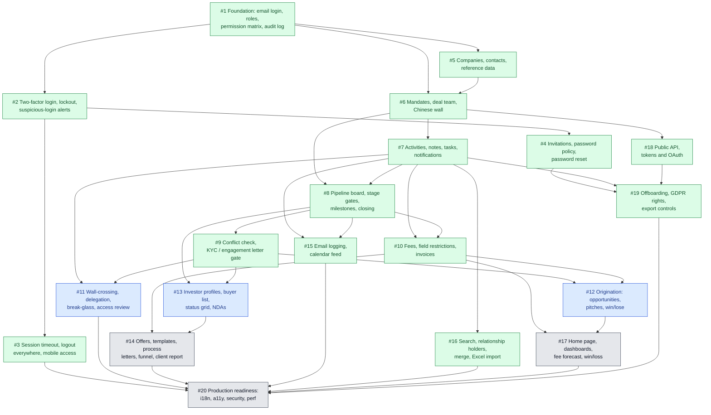

# M&A CRM ticket map

How the GitHub issues for the M&A CRM spec ([`docs/specs/ma-crm.md`](specs/ma-crm.md)) depend on each other. An arrow `A --> B` means A blocks B: B can start only once A is closed. GitHub holds the authoritative edges as native "blocked by" links on each issue.

## Critical path

`#1 → #5 → #6 → #7 → #8 → #9 → #12 → #17 → #20` is the longest chain (9 tickets). Everything else can run alongside it once its blockers close.

## Parallel waves

Tickets in the same wave have no edge between them and can be worked at the same time.

| Wave | Tickets |
|---|---|
| 1 | #1 |
| 2 | #2, #5 |
| 3 | #3, #4, #6 |
| 4 | #7, #18 |
| 5 | #8, #16, #19 |
| 6 | #9, #10, #15 |
| 7 | #11, #12, #13 |
| 8 | #14, #17 |
| 9 | #20 |

## All tickets

Every ticket with what blocks it, what it unblocks, and the user stories from the spec it covers. A story split across tickets appears in each one that carries some of its criteria.

| # | Ticket | Blocked by | Blocks | User stories |
|---|---|---|---|---|
| [#1](https://github.com/serge-merlin-innovation/testing-crm-creation/issues/1) | Foundation: email-only login, one role per user, permission matrix and append-only audit log | None | [#2](https://github.com/serge-merlin-innovation/testing-crm-creation/issues/2), [#5](https://github.com/serge-merlin-innovation/testing-crm-creation/issues/5), [#6](https://github.com/serge-merlin-innovation/testing-crm-creation/issues/6) | ROLE-01, AUTHZ-01, ADM-02, AUD-01 |
| [#2](https://github.com/serge-merlin-innovation/testing-crm-creation/issues/2) | Two-factor login, lockout and suspicious-login alerts | [#1](https://github.com/serge-merlin-innovation/testing-crm-creation/issues/1) | [#3](https://github.com/serge-merlin-innovation/testing-crm-creation/issues/3), [#4](https://github.com/serge-merlin-innovation/testing-crm-creation/issues/4) | AUTH-01, AUTH-02, AUTH-06, AUTH-12 |
| [#3](https://github.com/serge-merlin-innovation/testing-crm-creation/issues/3) | Session timeout, logout everywhere and mobile access | [#2](https://github.com/serge-merlin-innovation/testing-crm-creation/issues/2) | [#20](https://github.com/serge-merlin-innovation/testing-crm-creation/issues/20) | AUTH-03, AUTH-04, AUTH-07 |
| [#4](https://github.com/serge-merlin-innovation/testing-crm-creation/issues/4) | User onboarding by invitation, password policy and password reset | [#2](https://github.com/serge-merlin-innovation/testing-crm-creation/issues/2) | [#19](https://github.com/serge-merlin-innovation/testing-crm-creation/issues/19) | ADM-01, ADM-04, AUTH-08, AUTH-09, AUTH-10, AUTH-11 |
| [#5](https://github.com/serge-merlin-innovation/testing-crm-creation/issues/5) | Companies, contacts and reference data | [#1](https://github.com/serge-merlin-innovation/testing-crm-creation/issues/1) | [#6](https://github.com/serge-merlin-innovation/testing-crm-creation/issues/6) | CO-01, CO-02, CO-03, CON-01, ADM-06, GDPR-01 |
| [#6](https://github.com/serge-merlin-innovation/testing-crm-creation/issues/6) | Mandates with code names, deal team and the Chinese wall | [#1](https://github.com/serge-merlin-innovation/testing-crm-creation/issues/1), [#5](https://github.com/serge-merlin-innovation/testing-crm-creation/issues/5) | [#7](https://github.com/serge-merlin-innovation/testing-crm-creation/issues/7), [#8](https://github.com/serge-merlin-innovation/testing-crm-creation/issues/8), [#18](https://github.com/serge-merlin-innovation/testing-crm-creation/issues/18) | DEAL-01, DEAL-03, DEAL-07, AUTHZ-02, AUTHZ-03, ROLE-01, AUTH-01 |
| [#7](https://github.com/serge-merlin-innovation/testing-crm-creation/issues/7) | Activities, private notes, tasks and notification preferences | [#6](https://github.com/serge-merlin-innovation/testing-crm-creation/issues/6) | [#8](https://github.com/serge-merlin-innovation/testing-crm-creation/issues/8), [#10](https://github.com/serge-merlin-innovation/testing-crm-creation/issues/10), [#11](https://github.com/serge-merlin-innovation/testing-crm-creation/issues/11), [#15](https://github.com/serge-merlin-innovation/testing-crm-creation/issues/15), [#16](https://github.com/serge-merlin-innovation/testing-crm-creation/issues/16), [#19](https://github.com/serge-merlin-innovation/testing-crm-creation/issues/19) | ACT-01, ACT-02, ACT-03, ACT-06, AUTHZ-02 |
| [#8](https://github.com/serge-merlin-innovation/testing-crm-creation/issues/8) | Pipeline board, configurable stage gates, milestones and closing | [#6](https://github.com/serge-merlin-innovation/testing-crm-creation/issues/6), [#7](https://github.com/serge-merlin-innovation/testing-crm-creation/issues/7) | [#9](https://github.com/serge-merlin-innovation/testing-crm-creation/issues/9), [#10](https://github.com/serge-merlin-innovation/testing-crm-creation/issues/10), [#13](https://github.com/serge-merlin-innovation/testing-crm-creation/issues/13), [#15](https://github.com/serge-merlin-innovation/testing-crm-creation/issues/15) | DEAL-02, DEAL-08, DEAL-04, DEAL-06, AUTHZ-02 |
| [#9](https://github.com/serge-merlin-innovation/testing-crm-creation/issues/9) | Conflict check on new mandates and KYC / engagement letter gate | [#8](https://github.com/serge-merlin-innovation/testing-crm-creation/issues/8) | [#11](https://github.com/serge-merlin-innovation/testing-crm-creation/issues/11), [#12](https://github.com/serge-merlin-innovation/testing-crm-creation/issues/12), [#13](https://github.com/serge-merlin-innovation/testing-crm-creation/issues/13) | AUTHZ-05, DEAL-01, ORI-05 |
| [#10](https://github.com/serge-merlin-innovation/testing-crm-creation/issues/10) | Fees, field-level restrictions and invoices | [#8](https://github.com/serge-merlin-innovation/testing-crm-creation/issues/8), [#7](https://github.com/serge-merlin-innovation/testing-crm-creation/issues/7) | [#12](https://github.com/serge-merlin-innovation/testing-crm-creation/issues/12), [#14](https://github.com/serge-merlin-innovation/testing-crm-creation/issues/14), [#17](https://github.com/serge-merlin-innovation/testing-crm-creation/issues/17) | DEAL-05, AUTHZ-06, REP-07, ROLE-01 |
| [#11](https://github.com/serge-merlin-innovation/testing-crm-creation/issues/11) | Wall-crossing requests, delegation, break-glass and quarterly access review | [#9](https://github.com/serge-merlin-innovation/testing-crm-creation/issues/9), [#7](https://github.com/serge-merlin-innovation/testing-crm-creation/issues/7) | [#20](https://github.com/serge-merlin-innovation/testing-crm-creation/issues/20) | AUTHZ-04, AUTHZ-07, AUTHZ-08, ADM-05, AUTH-02 |
| [#12](https://github.com/serge-merlin-innovation/testing-crm-creation/issues/12) | Origination pipeline: opportunities, pitches and win/lose | [#9](https://github.com/serge-merlin-innovation/testing-crm-creation/issues/9), [#10](https://github.com/serge-merlin-innovation/testing-crm-creation/issues/10) | [#17](https://github.com/serge-merlin-innovation/testing-crm-creation/issues/17) | ORI-01, ORI-02, ORI-03, ORI-04 |
| [#13](https://github.com/serge-merlin-innovation/testing-crm-creation/issues/13) | Investor profiles, buyer long list, buyer status grid and NDA tracking | [#8](https://github.com/serge-merlin-innovation/testing-crm-creation/issues/8), [#9](https://github.com/serge-merlin-innovation/testing-crm-creation/issues/9) | [#14](https://github.com/serge-merlin-innovation/testing-crm-creation/issues/14) | CO-04, BUY-01, BUY-02, BUY-03, BUY-04, AUTHZ-02, CON-01 |
| [#14](https://github.com/serge-merlin-innovation/testing-crm-creation/issues/14) | Offers and bid comparison, templates, process letters, funnel and client report | [#13](https://github.com/serge-merlin-innovation/testing-crm-creation/issues/13), [#10](https://github.com/serge-merlin-innovation/testing-crm-creation/issues/10) | [#20](https://github.com/serge-merlin-innovation/testing-crm-creation/issues/20) | BUY-05, BUY-06, BUY-07, ADM-07, REP-05, CON-01, GDPR-01, DEAL-03 |
| [#15](https://github.com/serge-merlin-innovation/testing-crm-creation/issues/15) | Email logging by BCC/forward and private calendar feed | [#8](https://github.com/serge-merlin-innovation/testing-crm-creation/issues/8), [#7](https://github.com/serge-merlin-innovation/testing-crm-creation/issues/7) | [#20](https://github.com/serge-merlin-innovation/testing-crm-creation/issues/20) | ACT-04, ACT-05, CON-02, AUTHZ-02 |
| [#16](https://github.com/serge-merlin-innovation/testing-crm-creation/issues/16) | Global search, relationship holders, merge duplicates and Excel import | [#7](https://github.com/serge-merlin-innovation/testing-crm-creation/issues/7) | [#20](https://github.com/serge-merlin-innovation/testing-crm-creation/issues/20) | CON-03, CON-02, CON-04, CON-05 |
| [#17](https://github.com/serge-merlin-innovation/testing-crm-creation/issues/17) | Home page, firm pipeline dashboard, fee forecast and win/loss report | [#10](https://github.com/serge-merlin-innovation/testing-crm-creation/issues/10), [#12](https://github.com/serge-merlin-innovation/testing-crm-creation/issues/12) | [#20](https://github.com/serge-merlin-innovation/testing-crm-creation/issues/20) | REP-01, REP-02, REP-03, REP-04, AUTHZ-02, ROLE-01 |
| [#18](https://github.com/serge-merlin-innovation/testing-crm-creation/issues/18) | Public API with personal tokens and OAuth client credentials | [#6](https://github.com/serge-merlin-innovation/testing-crm-creation/issues/6) | [#19](https://github.com/serge-merlin-innovation/testing-crm-creation/issues/19) | NFR-05 |
| [#19](https://github.com/serge-merlin-innovation/testing-crm-creation/issues/19) | Offboarding with ownership hand-over, GDPR rights and export controls | [#4](https://github.com/serge-merlin-innovation/testing-crm-creation/issues/4), [#7](https://github.com/serge-merlin-innovation/testing-crm-creation/issues/7), [#18](https://github.com/serge-merlin-innovation/testing-crm-creation/issues/18) | [#20](https://github.com/serge-merlin-innovation/testing-crm-creation/issues/20) | AUTH-05, ADM-03, GDPR-02, GDPR-03, REP-06 |
| [#20](https://github.com/serge-merlin-innovation/testing-crm-creation/issues/20) | Production readiness: languages, accessibility, security, performance and availability | [#3](https://github.com/serge-merlin-innovation/testing-crm-creation/issues/3), [#11](https://github.com/serge-merlin-innovation/testing-crm-creation/issues/11), [#14](https://github.com/serge-merlin-innovation/testing-crm-creation/issues/14), [#15](https://github.com/serge-merlin-innovation/testing-crm-creation/issues/15), [#16](https://github.com/serge-merlin-innovation/testing-crm-creation/issues/16), [#17](https://github.com/serge-merlin-innovation/testing-crm-creation/issues/17), [#19](https://github.com/serge-merlin-innovation/testing-crm-creation/issues/19) | None | NFR-01, NFR-02, NFR-03, NFR-04, cross-cutting |
