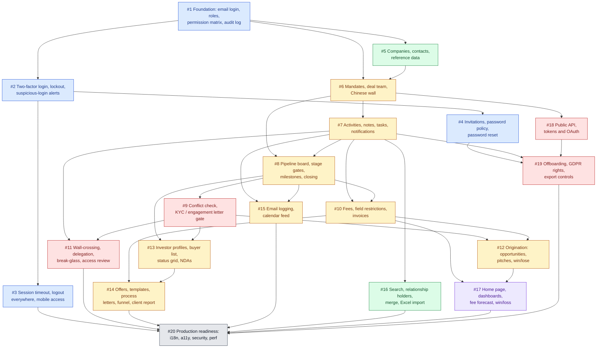

# M&A CRM ticket map

How the GitHub issues for the M&A CRM spec ([`docs/specs/ma-crm.md`](specs/ma-crm.md)) depend on each other. An arrow `A --> B` means A blocks B: B can start only once A is closed. GitHub holds the authoritative edges as native "blocked by" links on each issue.

Colours: blue is authentication, green is companies and contacts, amber is deal and buyer work, red is access control and compliance, purple is reporting, grey is the final production-readiness pass.

## Critical path

`#1 → #5 → #6 → #7 → #8 → #9 → #12 → #17 → #20` is the longest chain (9 tickets). Everything else can run alongside it once its blockers close.

## Parallel waves

Tickets in the same wave have no edge between them and can be worked at the same time.

| Wave | Tickets |
|---|---|
| 1 | #1 |
| 2 | #2, #5 |
| 3 | #3, #4, #6 |
| 4 | #7, #18 |
| 5 | #8, #16, #19 |
| 6 | #9, #10, #15 |
| 7 | #11, #12, #13 |
| 8 | #14, #17 |
| 9 | #20 |
